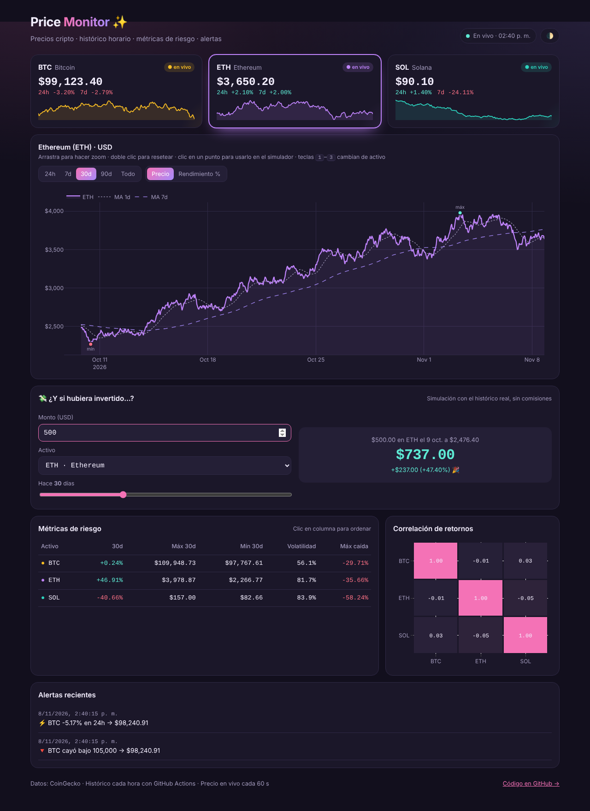

# 📈 Price Monitor

[](https://github.com/mapisaavedra/price-monitor/actions/workflows/update.yml)
[](https://github.com/mapisaavedra/price-monitor/actions/workflows/tests.yml)


Pipeline de datos **serverless** que monitorea precios de criptomonedas cada hora, calcula métricas de riesgo, envía alertas por Telegram y publica un dashboard interactivo en GitHub Pages. Costo de infraestructura: **$0**.

**🔗 Demo en vivo:** https://mapisaavedra.github.io/price-monitor/



## ¿Qué hace?

- **Ingesta horaria** desde la API de CoinGecko con reintentos y *backoff* exponencial (maneja límites de tasa `429`).
- **Backfill automático**: en el primer run (o al agregar un activo) descarga 90 días de histórico horario, así el dashboard tiene datos desde el día uno.
- **Almacenamiento versionado** en CSV formato largo (`timestamp, asset, price`), deduplicado por hora y commiteado por el bot: el historial de git es el historial de precios.
- **Analítica**: variación 24h/7d/30d, medias móviles, volatilidad anualizada, *max drawdown* y matriz de correlación de retornos.
- **Alertas** por umbral de precio y por movimiento brusco en 24h, con *cooldown* persistente para no repetir notificaciones.
- **Dashboard interactivo** (HTML + Plotly.js) que lee `data.json`:
  - Precio **en vivo** cada 60 s directamente desde el navegador, con animación al cambiar.
  - **Simulador** "¿y si hubiera invertido?": monto, activo y fecha (o clic en el gráfico).
  - Zoom arrastrando, rangos 24h–90d, comparación de rendimiento, marcadores de máximo y mínimo.
  - Tabla de métricas ordenable, heatmap de correlación clicable, atajos de teclado (`1`–`3`, `T`).
  - Tema claro/oscuro con selector manual y diseño responsive.

## Arquitectura

```
GitHub Actions (cron horario)
        │
        ▼
 sources.py ──► storage.py ──► analytics.py ──► alerts.py ──► Telegram
 (CoinGecko)    (data/*.csv)   (métricas)       (cooldown)
                                   │
                                   ▼
                             dashboard.py ──► docs/data.json ──► GitHub Pages (docs/index.html)
```

| Módulo | Responsabilidad |
|---|---|
| `config.py` | Carga y valida `config.yaml` en dataclasses tipadas |
| `sources.py` | Cliente HTTP con retry/backoff y API key opcional |
| `storage.py` | Persistencia en CSV, dedupe por hora |
| `analytics.py` | Cálculo de métricas con pandas |
| `alerts.py` | Reglas, cooldown y envío a Telegram |
| `dashboard.py` | Serializa todo a JSON para el frontend |

## Uso local

```bash
python -m venv .venv && source .venv/bin/activate   # Windows: .venv\Scripts\activate
pip install -r requirements.txt
python -m price_monitor                     # descarga, calcula y genera docs/data.json
python -m http.server -d docs 8000          # abre http://localhost:8000
```

Tests y lint:

```bash
pip install -r requirements-dev.txt
pytest -q && ruff check .
```

## Configuración

Edita `config.yaml` para agregar activos (cualquier ID de CoinGecko) y reglas de alerta:

```yaml
- id: solana
  symbol: SOL
  color: "#14b8a6"
  alerts:
    above: 250
    move_pct_24h: 8
```

**Secretos** (Settings → Secrets and variables → Actions), todos opcionales:

| Secreto | Uso |
|---|---|
| `TELEGRAM_BOT_TOKEN` / `TELEGRAM_CHAT_ID` | Notificaciones de alertas |
| `COINGECKO_API_KEY` | API key demo gratuita para más cuota |

## Precisión de los datos

| Dato | Frecuencia | Fuente |
|---|---|---|
| Precio en las tarjetas | cada 60 s (navegador) | CoinGecko `/simple/price` |
| Histórico y métricas | cada hora (GitHub Actions) | CoinGecko `/market_chart` |

- CoinGecko publica un **promedio ponderado por volumen de cientos de exchanges**, así que puede diferir ±0.1–0.5% del precio de un exchange concreto.
- En el plan gratuito, CoinGecko cachea las respuestas ~1–5 minutos.
- El cron de GitHub Actions no es exacto: puede retrasarse de 5 a 30 min en horas de carga.
- Las métricas usan cierres horarios: no capturan picos intra-hora.

Es apto para seguimiento y análisis, **no para trading de alta frecuencia**.

## Decisiones de diseño

- **Git como base de datos**: para volúmenes pequeños, commitear el CSV da historial, auditoría y hosting gratis sin servidor.
- **Formato largo en vez de ancho**: agregar o quitar activos no rompe el archivo existente.
- **Datos separados de la presentación**: Python solo produce JSON; el frontend se puede rediseñar sin tocar el pipeline.
- **Tests sin red**: una fuente falsa y `responses` simulan la API, así CI es rápido y determinista.

## Stack

Python · pandas · requests · PyYAML · Plotly.js · GitHub Actions · GitHub Pages · pytest · ruff
